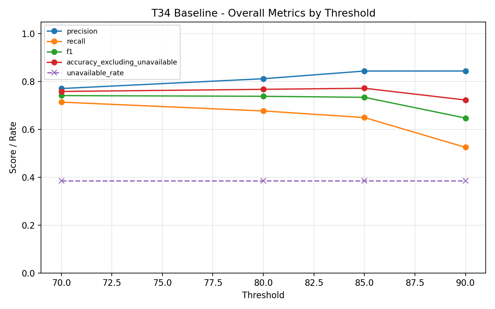
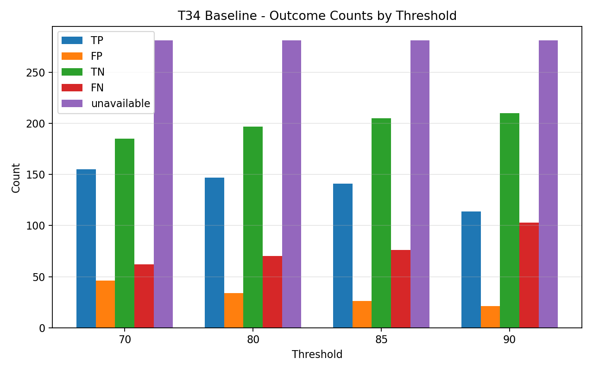
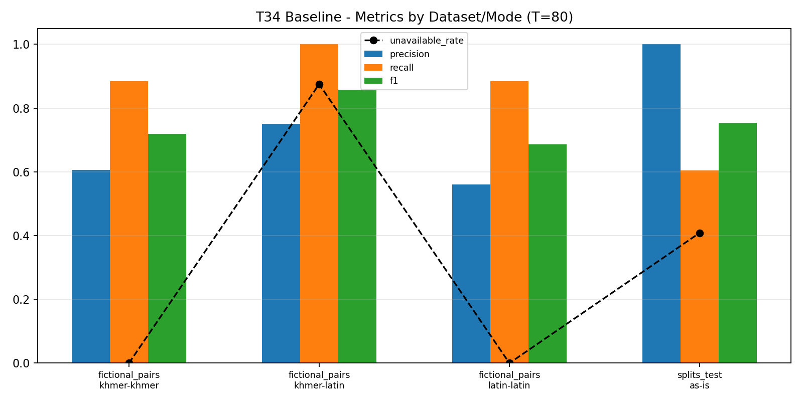
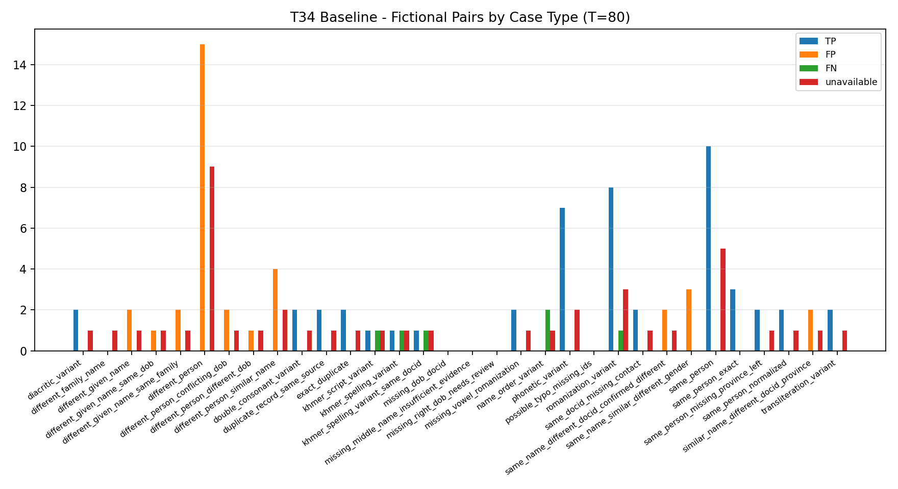
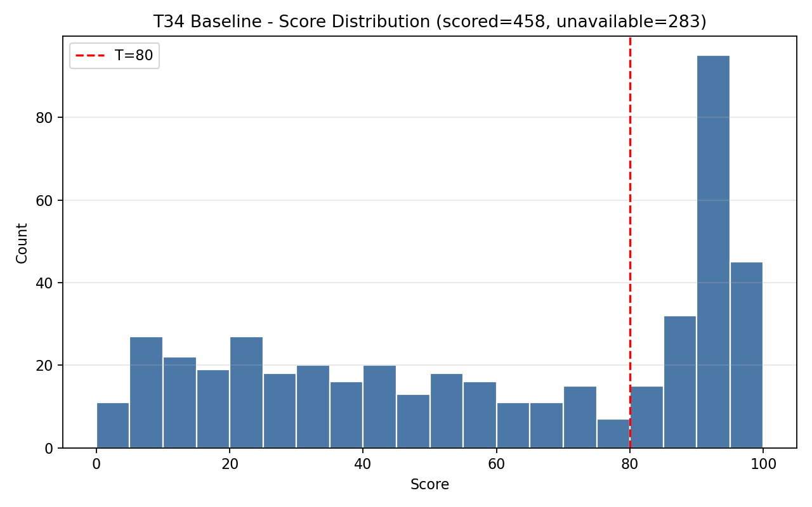
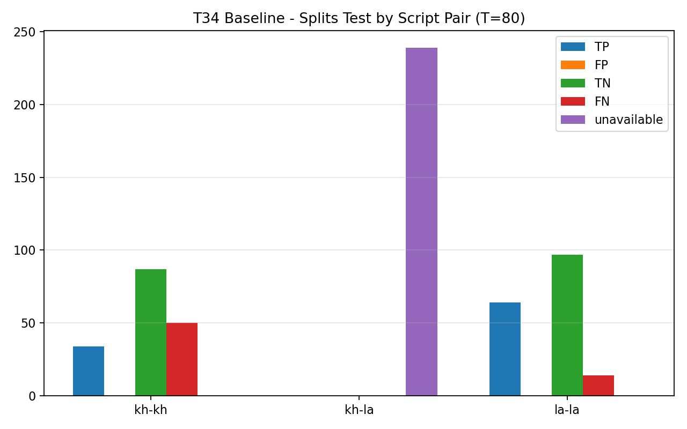

# T34 - Baseline Matching Test Report

## Summary
- Generated: 2026-11-28T08:34:03.502537+00:00
- Git commit: `f38188cb7863d537e49451a2d98de92541e38747`
- Baseline: `matching-algorithm/name_similarity.py::compare_names` (Levenshtein; dictionary-assisted Khmer-Latin only for exact `KHMER_VARIANTS` hit)
- Datasets: `data/samples/fictional_pairs.csv` (156 evaluations = 52 pairs x 3 modes), `data/splits/test.csv` (585 rows as-is)
- Default threshold: 80; sensitivity also reported at [70, 80, 85, 90]
- Uncertain label `-1` excluded from binary P/R/F1/confusion matrix; counted separately.

## Visual Analysis

| Overall metrics by threshold | Outcome counts by threshold |
|---|---|
|  |  |

| Dataset/mode metrics (T=80) | Fictional case types (T=80) |
|---|---|
|  |  |

| Score distribution | Splits test by script pair (T=80) |
|---|---|
|  |  |

## Overall Metrics
| Threshold | Total | Excluded -1 | Binary+Unavail | Binary eval | TP | FP | TN | FN | Unavailable | Unavail rate | Precision | Recall | F1 | Acc(excl unavail) |
| --- | --- | --- | --- | --- | --- | --- | --- | --- | --- | --- | --- | --- | --- | --- |
| 70 | 741 | 12 | 729 | 448 | 155 | 46 | 185 | 62 | 281 | 0.3855 | 0.7711 | 0.7143 | 0.7416 | 0.7589 |
| 80 | 741 | 12 | 729 | 448 | 147 | 34 | 197 | 70 | 281 | 0.3855 | 0.8122 | 0.6774 | 0.7387 | 0.7679 |
| 85 | 741 | 12 | 729 | 448 | 141 | 26 | 205 | 76 | 281 | 0.3855 | 0.8443 | 0.6498 | 0.7344 | 0.7723 |
| 90 | 741 | 12 | 729 | 448 | 114 | 21 | 210 | 103 | 281 | 0.3855 | 0.8444 | 0.5253 | 0.6477 | 0.7232 |

## Dataset: fictional_pairs
| Mode/Group | Threshold | Total | Excl -1 | TP | FP | TN | FN | Unavail | Precision | Recall | F1 |
| --- | --- | --- | --- | --- | --- | --- | --- | --- | --- | --- | --- |
| khmer-khmer | 70 | 52 | 4 | 23 | 19 | 3 | 3 | 0 | 0.5476 | 0.8846 | 0.6765 |
| khmer-khmer | 80 | 52 | 4 | 23 | 15 | 7 | 3 | 0 | 0.6053 | 0.8846 | 0.7188 |
| khmer-khmer | 85 | 52 | 4 | 23 | 11 | 11 | 3 | 0 | 0.6765 | 0.8846 | 0.7667 |
| khmer-khmer | 90 | 52 | 4 | 22 | 8 | 14 | 4 | 0 | 0.7333 | 0.8462 | 0.7857 |
| khmer-latin | 70 | 52 | 4 | 3 | 2 | 1 | 0 | 42 | 0.6000 | 1.0000 | 0.7500 |
| khmer-latin | 80 | 52 | 4 | 3 | 1 | 2 | 0 | 42 | 0.7500 | 1.0000 | 0.8571 |
| khmer-latin | 85 | 52 | 4 | 3 | 1 | 2 | 0 | 42 | 0.7500 | 1.0000 | 0.8571 |
| khmer-latin | 90 | 52 | 4 | 3 | 1 | 2 | 0 | 42 | 0.7500 | 1.0000 | 0.8571 |
| latin-latin | 70 | 52 | 4 | 25 | 21 | 1 | 1 | 0 | 0.5435 | 0.9615 | 0.6944 |
| latin-latin | 80 | 52 | 4 | 23 | 18 | 4 | 3 | 0 | 0.5610 | 0.8846 | 0.6866 |
| latin-latin | 85 | 52 | 4 | 22 | 14 | 8 | 4 | 0 | 0.6111 | 0.8462 | 0.7097 |
| latin-latin | 90 | 52 | 4 | 22 | 12 | 10 | 4 | 0 | 0.6471 | 0.8462 | 0.7333 |

### fictional_pairs by case_type (threshold 80)
| case_type | Total | Excl -1 | TP | FP | TN | FN | Unavail | Precision | Recall | F1 |
| --- | --- | --- | --- | --- | --- | --- | --- | --- | --- | --- |
| diacritic_variant | 3 | 0 | 2 | 0 | 0 | 0 | 1 | 1.0000 | 1.0000 | 1.0000 |
| different_family_name | 3 | 0 | 0 | 0 | 2 | 0 | 1 | N/A | N/A | N/A |
| different_given_name | 3 | 0 | 0 | 2 | 0 | 0 | 1 | 0.0000 | N/A | 0.0000 |
| different_given_name_same_dob | 3 | 0 | 0 | 1 | 1 | 0 | 1 | 0.0000 | N/A | 0.0000 |
| different_given_name_same_family | 3 | 0 | 0 | 2 | 0 | 0 | 1 | 0.0000 | N/A | 0.0000 |
| different_person | 30 | 0 | 0 | 15 | 6 | 0 | 9 | 0.0000 | N/A | 0.0000 |
| different_person_conflicting_dob | 3 | 0 | 0 | 2 | 0 | 0 | 1 | 0.0000 | N/A | 0.0000 |
| different_person_different_dob | 6 | 0 | 0 | 1 | 4 | 0 | 1 | 0.0000 | N/A | 0.0000 |
| different_person_similar_name | 6 | 0 | 0 | 4 | 0 | 0 | 2 | 0.0000 | N/A | 0.0000 |
| double_consonant_variant | 3 | 0 | 2 | 0 | 0 | 0 | 1 | 1.0000 | 1.0000 | 1.0000 |
| duplicate_record_same_source | 3 | 0 | 2 | 0 | 0 | 0 | 1 | 1.0000 | 1.0000 | 1.0000 |
| exact_duplicate | 3 | 0 | 2 | 0 | 0 | 0 | 1 | 1.0000 | 1.0000 | 1.0000 |
| khmer_script_variant | 3 | 0 | 1 | 0 | 0 | 1 | 1 | 1.0000 | 0.5000 | 0.6667 |
| khmer_spelling_variant | 3 | 0 | 1 | 0 | 0 | 1 | 1 | 1.0000 | 0.5000 | 0.6667 |
| khmer_spelling_variant_same_docid | 3 | 0 | 1 | 0 | 0 | 1 | 1 | 1.0000 | 0.5000 | 0.6667 |
| missing_dob_docid | 3 | 3 | 0 | 0 | 0 | 0 | 0 | N/A | N/A | N/A |
| missing_middle_name_insufficient_evidence | 3 | 3 | 0 | 0 | 0 | 0 | 0 | N/A | N/A | N/A |
| missing_right_dob_needs_review | 3 | 3 | 0 | 0 | 0 | 0 | 0 | N/A | N/A | N/A |
| missing_vowel_romanization | 3 | 0 | 2 | 0 | 0 | 0 | 1 | 1.0000 | 1.0000 | 1.0000 |
| name_order_variant | 3 | 0 | 0 | 0 | 0 | 2 | 1 | N/A | 0.0000 | 0.0000 |
| phonetic_variant | 9 | 0 | 7 | 0 | 0 | 0 | 2 | 1.0000 | 1.0000 | 1.0000 |
| possible_typo_missing_ids | 3 | 3 | 0 | 0 | 0 | 0 | 0 | N/A | N/A | N/A |
| romanization_variant | 12 | 0 | 8 | 0 | 0 | 1 | 3 | 1.0000 | 0.8889 | 0.9412 |
| same_docid_missing_contact | 3 | 0 | 2 | 0 | 0 | 0 | 1 | 1.0000 | 1.0000 | 1.0000 |
| same_name_different_docid_confirmed_different | 3 | 0 | 0 | 2 | 0 | 0 | 1 | 0.0000 | N/A | 0.0000 |
| same_name_similar_different_gender | 3 | 0 | 0 | 3 | 0 | 0 | 0 | 0.0000 | N/A | 0.0000 |
| same_person | 15 | 0 | 10 | 0 | 0 | 0 | 5 | 1.0000 | 1.0000 | 1.0000 |
| same_person_exact | 3 | 0 | 3 | 0 | 0 | 0 | 0 | 1.0000 | 1.0000 | 1.0000 |
| same_person_missing_province_left | 3 | 0 | 2 | 0 | 0 | 0 | 1 | 1.0000 | 1.0000 | 1.0000 |
| same_person_normalized | 3 | 0 | 2 | 0 | 0 | 0 | 1 | 1.0000 | 1.0000 | 1.0000 |
| similar_name_different_docid_province | 3 | 0 | 0 | 2 | 0 | 0 | 1 | 0.0000 | N/A | 0.0000 |
| transliteration_variant | 3 | 0 | 2 | 0 | 0 | 0 | 1 | 1.0000 | 1.0000 | 1.0000 |

## Dataset: splits_test
| Mode/Group | Threshold | Total | Excl -1 | TP | FP | TN | FN | Unavail | Precision | Recall | F1 |
| --- | --- | --- | --- | --- | --- | --- | --- | --- | --- | --- | --- |
| as-is | 70 | 585 | 0 | 104 | 4 | 180 | 58 | 239 | 0.9630 | 0.6420 | 0.7704 |
| as-is | 80 | 585 | 0 | 98 | 0 | 184 | 64 | 239 | 1.0000 | 0.6049 | 0.7538 |
| as-is | 85 | 585 | 0 | 93 | 0 | 184 | 69 | 239 | 1.0000 | 0.5741 | 0.7294 |
| as-is | 90 | 585 | 0 | 67 | 0 | 184 | 95 | 239 | 1.0000 | 0.4136 | 0.5852 |

### splits_test by case_type (threshold 80)
| case_type | Total | Excl -1 | TP | FP | TN | FN | Unavail | Precision | Recall | F1 |
| --- | --- | --- | --- | --- | --- | --- | --- | --- | --- | --- |
| easy_negative | 86 | 0 | 0 | 0 | 58 | 0 | 28 | N/A | N/A | N/A |
| hard_negative | 210 | 0 | 0 | 0 | 126 | 0 | 84 | N/A | N/A | N/A |
| order_or_format | 109 | 0 | 48 | 0 | 0 | 61 | 0 | 1.0000 | 0.4404 | 0.6115 |
| phonetic_variant | 41 | 0 | 0 | 0 | 0 | 0 | 41 | N/A | N/A | N/A |
| romanisation_variant | 53 | 0 | 50 | 0 | 0 | 3 | 0 | 1.0000 | 0.9434 | 0.9709 |
| transliteration | 86 | 0 | 0 | 0 | 0 | 0 | 86 | N/A | N/A | N/A |

## Mistakes and Unavailable Cases (default threshold 80)
- Total flagged rows: 397 (FP/FN/unavailable/uncertain-excluded)
- FP/FN/unavailable: 385; uncertain excluded: 12

### FP/FN/Unavailable Details
| dataset | pair_id | mode | script | case_type | label | score | method | pred | outcome | name_a | name_b | explanation |
| --- | --- | --- | --- | --- | --- | --- | --- | --- | --- | --- | --- | --- |
| fictional_pairs | T53-P004 | khmer-latin | kh-la | transliteration_variant | 1 | N/A | unavailable | unavailable | unavailable | ហេង វណ្ណា | Heng Wannar | No score available: the Khmer name has no exact entry in this demo dictionary. Add a reviewed romanisation candidate before comparing across scripts. |
| fictional_pairs | T53-P005 | khmer-latin | kh-la | duplicate_record_same_source | 1 | N/A | unavailable | unavailable | unavailable | ជា មករា | Chea Makara | No score available: the Khmer name has no exact entry in this demo dictionary. Add a reviewed romanisation candidate before comparing across scripts. |
| fictional_pairs | T53-P006 | khmer-latin | kh-la | missing_vowel_romanization | 1 | N/A | unavailable | unavailable | unavailable | ពៅ សុវណ្ណ | Pov Sovan | No score available: the Khmer name has no exact entry in this demo dictionary. Add a reviewed romanisation candidate before comparing across scripts. |
| fictional_pairs | T53-P007 | latin-latin | la-la | romanization_variant | 1 | 73 | Levenshtein | non_match | FN | Sun Chenda | Sun Chantha | Levenshtein distance is 3 edit(s) over 11 Unicode code points; similarity is 73%. This is character similarity, not phonetic similarity or evidence of identity. |
| fictional_pairs | T53-P007 | khmer-latin | kh-la | romanization_variant | 1 | N/A | unavailable | unavailable | unavailable | ស៊ុន ចន្ទា | Sun Chantha | No score available: the Khmer name has no exact entry in this demo dictionary. Add a reviewed romanisation candidate before comparing across scripts. |
| fictional_pairs | T53-P008 | khmer-latin | kh-la | double_consonant_variant | 1 | N/A | unavailable | unavailable | unavailable | វណ្ណ រតនា | Vann Rattana | No score available: the Khmer name has no exact entry in this demo dictionary. Add a reviewed romanisation candidate before comparing across scripts. |
| fictional_pairs | T53-P009 | khmer-latin | kh-la | same_person_normalized | 1 | N/A | unavailable | unavailable | unavailable | រិទ្ធ សំណាង | Rith Samnang | No score available: the Khmer name has no exact entry in this demo dictionary. Add a reviewed romanisation candidate before comparing across scripts. |
| fictional_pairs | T53-P010 | khmer-latin | kh-la | phonetic_variant | 1 | N/A | unavailable | unavailable | unavailable | ដារ៉ា វិសាល | Dara Vissal | No score available: the Khmer name has no exact entry in this demo dictionary. Add a reviewed romanisation candidate before comparing across scripts. |
| fictional_pairs | T53-P011 | khmer-latin | kh-la | same_person | 1 | N/A | unavailable | unavailable | unavailable | សុភក្ត្រ ប៊ុនថាន | Sopheak Bunthan | No score available: the Khmer name has no exact entry in this demo dictionary. Add a reviewed romanisation candidate before comparing across scripts. |
| fictional_pairs | T53-P012 | latin-latin | la-la | name_order_variant | 1 | 9 | Levenshtein | non_match | FN | Neary Sokha | Sokha Neary | Levenshtein distance is 10 edit(s) over 11 Unicode code points; similarity is 9%. This is character similarity, not phonetic similarity or evidence of identity. |
| fictional_pairs | T53-P012 | khmer-khmer | kh-kh | name_order_variant | 1 | 11 | Levenshtein | non_match | FN | នារី សុខា | សុខា នារី | Levenshtein distance is 8 edit(s) over 9 Unicode code points; similarity is 11%. This is character similarity, not phonetic similarity or evidence of identity. |
| fictional_pairs | T53-P012 | khmer-latin | kh-la | name_order_variant | 1 | N/A | unavailable | unavailable | unavailable | នារី សុខា | Sokha Neary | No score available: the Khmer name has no exact entry in this demo dictionary. Add a reviewed romanisation candidate before comparing across scripts. |
| fictional_pairs | T53-P013 | khmer-latin | kh-la | exact_duplicate | 1 | N/A | unavailable | unavailable | unavailable | មាលា បុប្ផា | Malea Bopha | No score available: the Khmer name has no exact entry in this demo dictionary. Add a reviewed romanisation candidate before comparing across scripts. |
| fictional_pairs | T53-P014 | khmer-latin | kh-la | romanization_variant | 1 | N/A | unavailable | unavailable | unavailable | កញ្ញា ទេពី | Kanha Tepy | No score available: the Khmer name has no exact entry in this demo dictionary. Add a reviewed romanisation candidate before comparing across scripts. |
| fictional_pairs | T53-P015 | khmer-latin | kh-la | same_person | 1 | N/A | unavailable | unavailable | unavailable | វិសាល ពិសិដ្ឋ | Visal Piseth | No score available: the Khmer name has no exact entry in this demo dictionary. Add a reviewed romanisation candidate before comparing across scripts. |
| fictional_pairs | T53-P016 | khmer-latin | kh-la | phonetic_variant | 1 | N/A | unavailable | unavailable | unavailable | ស្រីមុំ វច្ឆនា | Sreymom Wachana | No score available: the Khmer name has no exact entry in this demo dictionary. Add a reviewed romanisation candidate before comparing across scripts. |
| fictional_pairs | T53-P017 | khmer-latin | kh-la | same_person | 1 | N/A | unavailable | unavailable | unavailable | ម៉េង កក្កដា | Meng Kakada | No score available: the Khmer name has no exact entry in this demo dictionary. Add a reviewed romanisation candidate before comparing across scripts. |
| fictional_pairs | T53-P018 | khmer-latin | kh-la | same_person | 1 | N/A | unavailable | unavailable | unavailable | វុត្ថា ណារិន | Vuthea Narin | No score available: the Khmer name has no exact entry in this demo dictionary. Add a reviewed romanisation candidate before comparing across scripts. |
| fictional_pairs | T53-P019 | khmer-latin | kh-la | romanization_variant | 1 | N/A | unavailable | unavailable | unavailable | លក្ខិណា សីហា | Leakena Seiha | No score available: the Khmer name has no exact entry in this demo dictionary. Add a reviewed romanisation candidate before comparing across scripts. |
| fictional_pairs | T53-P020 | khmer-latin | kh-la | same_person | 1 | N/A | unavailable | unavailable | unavailable | បុប្ផា រិទ្ធី | Bopha Rithy | No score available: the Khmer name has no exact entry in this demo dictionary. Add a reviewed romanisation candidate before comparing across scripts. |
| fictional_pairs | T53-P022 | latin-latin | la-la | same_name_similar_different_gender | 0 | 92 | Levenshtein | match | FP | Chan Sophea | Chan Sopheap | Levenshtein distance is 1 edit(s) over 12 Unicode code points; similarity is 92%. This is character similarity, not phonetic similarity or evidence of identity. |
| fictional_pairs | T53-P022 | khmer-khmer | kh-kh | same_name_similar_different_gender | 0 | 90 | Levenshtein | match | FP | ចាន់ សុភា | ចាន់ សុភាព | Levenshtein distance is 1 edit(s) over 10 Unicode code points; similarity is 90%. This is character similarity, not phonetic similarity or evidence of identity. |
| fictional_pairs | T53-P022 | khmer-latin | kh-la | same_name_similar_different_gender | 0 | 92 | dictionary-assisted Levenshtein | match | FP | ចាន់ សុភា | Chan Sopheap | Best dictionary match: "Chan Sophea" (mock-reference). Levenshtein distance is 1 edit(s) over 12 Unicode code points; similarity is 92%. Verify this candidate a |
| fictional_pairs | T53-P024 | latin-latin | la-la | different_person_conflicting_dob | 0 | 91 | Levenshtein | match | FP | Heng Vanna | Heng Vannah | Levenshtein distance is 1 edit(s) over 11 Unicode code points; similarity is 91%. This is character similarity, not phonetic similarity or evidence of identity. |
| fictional_pairs | T53-P024 | khmer-khmer | kh-kh | different_person_conflicting_dob | 0 | 89 | Levenshtein | match | FP | ហេង វណ្ណា | ហេង វណ្ណះ | Levenshtein distance is 1 edit(s) over 9 Unicode code points; similarity is 89%. This is character similarity, not phonetic similarity or evidence of identity. |
| fictional_pairs | T53-P024 | khmer-latin | kh-la | different_person_conflicting_dob | 0 | N/A | unavailable | unavailable | unavailable | ហេង វណ្ណា | Heng Vannah | No score available: the Khmer name has no exact entry in this demo dictionary. Add a reviewed romanisation candidate before comparing across scripts. |
| fictional_pairs | T53-P025 | latin-latin | la-la | similar_name_different_docid_province | 0 | 82 | Levenshtein | match | FP | Chea Makara | Chea Makor | Levenshtein distance is 2 edit(s) over 11 Unicode code points; similarity is 82%. This is character similarity, not phonetic similarity or evidence of identity. |
| fictional_pairs | T53-P025 | khmer-khmer | kh-kh | similar_name_different_docid_province | 0 | 86 | Levenshtein | match | FP | ជា មករា | ជា មករ | Levenshtein distance is 1 edit(s) over 7 Unicode code points; similarity is 86%. This is character similarity, not phonetic similarity or evidence of identity. |
| fictional_pairs | T53-P025 | khmer-latin | kh-la | similar_name_different_docid_province | 0 | N/A | unavailable | unavailable | unavailable | ជា មករា | Chea Makor | No score available: the Khmer name has no exact entry in this demo dictionary. Add a reviewed romanisation candidate before comparing across scripts. |
| fictional_pairs | T53-P026 | khmer-latin | kh-la | different_person | 0 | N/A | unavailable | unavailable | unavailable | ពៅ សុវណ្ណ | Pov Sovannary | No score available: the Khmer name has no exact entry in this demo dictionary. Add a reviewed romanisation candidate before comparing across scripts. |
| fictional_pairs | T53-P027 | latin-latin | la-la | different_person | 0 | 80 | Levenshtein | match | FP | Sun Chenda | Sun Chandu | Levenshtein distance is 2 edit(s) over 10 Unicode code points; similarity is 80%. This is character similarity, not phonetic similarity or evidence of identity. |
| fictional_pairs | T53-P027 | khmer-khmer | kh-kh | different_person | 0 | 90 | Levenshtein | match | FP | ស៊ុន ចន្ទា | ស៊ុន ចន្ទូ | Levenshtein distance is 1 edit(s) over 10 Unicode code points; similarity is 90%. This is character similarity, not phonetic similarity or evidence of identity. |
| fictional_pairs | T53-P027 | khmer-latin | kh-la | different_person | 0 | N/A | unavailable | unavailable | unavailable | ស៊ុន ចន្ទា | Sun Chandu | No score available: the Khmer name has no exact entry in this demo dictionary. Add a reviewed romanisation candidate before comparing across scripts. |
| fictional_pairs | T53-P028 | khmer-latin | kh-la | different_family_name | 0 | N/A | unavailable | unavailable | unavailable | វណ្ណ រតនា | Vuth Ratana | No score available: the Khmer name has no exact entry in this demo dictionary. Add a reviewed romanisation candidate before comparing across scripts. |
| fictional_pairs | T53-P029 | latin-latin | la-la | different_person | 0 | 92 | Levenshtein | match | FP | Rith Samnang | Rithy Samnang | Levenshtein distance is 1 edit(s) over 13 Unicode code points; similarity is 92%. This is character similarity, not phonetic similarity or evidence of identity. |
| fictional_pairs | T53-P029 | khmer-khmer | kh-kh | different_person | 0 | 92 | Levenshtein | match | FP | រិទ្ធ សំណាង | រិទ្ធី សំណាង | Levenshtein distance is 1 edit(s) over 12 Unicode code points; similarity is 92%. This is character similarity, not phonetic similarity or evidence of identity. |
| fictional_pairs | T53-P029 | khmer-latin | kh-la | different_person | 0 | N/A | unavailable | unavailable | unavailable | រិទ្ធ សំណាង | Rithy Samnang | No score available: the Khmer name has no exact entry in this demo dictionary. Add a reviewed romanisation candidate before comparing across scripts. |
| fictional_pairs | T53-P030 | latin-latin | la-la | different_given_name | 0 | 82 | Levenshtein | match | FP | Dara Visal | Darin Visal | Levenshtein distance is 2 edit(s) over 11 Unicode code points; similarity is 82%. This is character similarity, not phonetic similarity or evidence of identity. |
| fictional_pairs | T53-P030 | khmer-khmer | kh-kh | different_given_name | 0 | 82 | Levenshtein | match | FP | ដារ៉ា វិសាល | ដារិន វិសាល | Levenshtein distance is 2 edit(s) over 11 Unicode code points; similarity is 82%. This is character similarity, not phonetic similarity or evidence of identity. |
| fictional_pairs | T53-P030 | khmer-latin | kh-la | different_given_name | 0 | N/A | unavailable | unavailable | unavailable | ដារ៉ា វិសាល | Darin Visal | No score available: the Khmer name has no exact entry in this demo dictionary. Add a reviewed romanisation candidate before comparing across scripts. |
| fictional_pairs | T53-P031 | latin-latin | la-la | different_person | 0 | 87 | Levenshtein | match | FP | Sopheak Bunthan | Sopheak Bunthy | Levenshtein distance is 2 edit(s) over 15 Unicode code points; similarity is 87%. This is character similarity, not phonetic similarity or evidence of identity. |
| fictional_pairs | T53-P031 | khmer-latin | kh-la | different_person | 0 | N/A | unavailable | unavailable | unavailable | សុភក្ត្រ ប៊ុនថាន | Sopheak Bunthy | No score available: the Khmer name has no exact entry in this demo dictionary. Add a reviewed romanisation candidate before comparing across scripts. |
| fictional_pairs | T53-P032 | latin-latin | la-la | different_person_similar_name | 0 | 91 | Levenshtein | match | FP | Neary Sokha | Nary Sokha | Levenshtein distance is 1 edit(s) over 11 Unicode code points; similarity is 91%. This is character similarity, not phonetic similarity or evidence of identity. |
| fictional_pairs | T53-P032 | khmer-khmer | kh-kh | different_person_similar_name | 0 | 89 | Levenshtein | match | FP | នារី សុខា | ណារី សុខា | Levenshtein distance is 1 edit(s) over 9 Unicode code points; similarity is 89%. This is character similarity, not phonetic similarity or evidence of identity. |
| fictional_pairs | T53-P032 | khmer-latin | kh-la | different_person_similar_name | 0 | N/A | unavailable | unavailable | unavailable | នារី សុខា | Nary Sokha | No score available: the Khmer name has no exact entry in this demo dictionary. Add a reviewed romanisation candidate before comparing across scripts. |
| fictional_pairs | T53-P033 | latin-latin | la-la | different_given_name_same_dob | 0 | 82 | Levenshtein | match | FP | Malea Bopha | Malis Bopha | Levenshtein distance is 2 edit(s) over 11 Unicode code points; similarity is 82%. This is character similarity, not phonetic similarity or evidence of identity. |
| fictional_pairs | T53-P033 | khmer-latin | kh-la | different_given_name_same_dob | 0 | N/A | unavailable | unavailable | unavailable | មាលា បុប្ផា | Malis Bopha | No score available: the Khmer name has no exact entry in this demo dictionary. Add a reviewed romanisation candidate before comparing across scripts. |
| fictional_pairs | T53-P034 | latin-latin | la-la | different_person | 0 | 90 | Levenshtein | match | FP | Kanha Tepi | Kanha Tep | Levenshtein distance is 1 edit(s) over 10 Unicode code points; similarity is 90%. This is character similarity, not phonetic similarity or evidence of identity. |
| fictional_pairs | T53-P034 | khmer-khmer | kh-kh | different_person | 0 | 90 | Levenshtein | match | FP | កញ្ញា ទេពី | កញ្ញា ទេព | Levenshtein distance is 1 edit(s) over 10 Unicode code points; similarity is 90%. This is character similarity, not phonetic similarity or evidence of identity. |
| fictional_pairs | T53-P034 | khmer-latin | kh-la | different_person | 0 | N/A | unavailable | unavailable | unavailable | កញ្ញា ទេពី | Kanha Tep | No score available: the Khmer name has no exact entry in this demo dictionary. Add a reviewed romanisation candidate before comparing across scripts. |
| fictional_pairs | T53-P035 | latin-latin | la-la | different_person | 0 | 92 | Levenshtein | match | FP | Visal Piseth | Visa Piseth | Levenshtein distance is 1 edit(s) over 12 Unicode code points; similarity is 92%. This is character similarity, not phonetic similarity or evidence of identity. |
| fictional_pairs | T53-P035 | khmer-khmer | kh-kh | different_person | 0 | 92 | Levenshtein | match | FP | វិសាល ពិសិដ្ឋ | វិសា ពិសិដ្ឋ | Levenshtein distance is 1 edit(s) over 13 Unicode code points; similarity is 92%. This is character similarity, not phonetic similarity or evidence of identity. |
| fictional_pairs | T53-P035 | khmer-latin | kh-la | different_person | 0 | N/A | unavailable | unavailable | unavailable | វិសាល ពិសិដ្ឋ | Visa Piseth | No score available: the Khmer name has no exact entry in this demo dictionary. Add a reviewed romanisation candidate before comparing across scripts. |
| fictional_pairs | T53-P036 | latin-latin | la-la | different_person_different_dob | 0 | 100 | Levenshtein | match | FP | Sreymom Vachana | Sreymom Vachana | Levenshtein distance is 0 edit(s) over 15 Unicode code points; similarity is 100%. This is character similarity, not phonetic similarity or evidence of identity |
| fictional_pairs | T53-P036 | khmer-latin | kh-la | different_person_different_dob | 0 | N/A | unavailable | unavailable | unavailable | ស្រីមុំ វច្ឆនា | Sreymom Vachana | No score available: the Khmer name has no exact entry in this demo dictionary. Add a reviewed romanisation candidate before comparing across scripts. |
| fictional_pairs | T53-P037 | latin-latin | la-la | different_person | 0 | 91 | Levenshtein | match | FP | Meng Kakada | Meng Kakda | Levenshtein distance is 1 edit(s) over 11 Unicode code points; similarity is 91%. This is character similarity, not phonetic similarity or evidence of identity. |
| fictional_pairs | T53-P037 | khmer-khmer | kh-kh | different_person | 0 | 91 | Levenshtein | match | FP | ម៉េង កក្កដា | ម៉េង កក្ដា | Levenshtein distance is 1 edit(s) over 11 Unicode code points; similarity is 91%. This is character similarity, not phonetic similarity or evidence of identity. |
| fictional_pairs | T53-P037 | khmer-latin | kh-la | different_person | 0 | N/A | unavailable | unavailable | unavailable | ម៉េង កក្កដា | Meng Kakda | No score available: the Khmer name has no exact entry in this demo dictionary. Add a reviewed romanisation candidate before comparing across scripts. |
| fictional_pairs | T53-P038 | latin-latin | la-la | different_person | 0 | 85 | Levenshtein | match | FP | Vuthea Narin | Vuthea Narith | Levenshtein distance is 2 edit(s) over 13 Unicode code points; similarity is 85%. This is character similarity, not phonetic similarity or evidence of identity. |
| fictional_pairs | T53-P038 | khmer-khmer | kh-kh | different_person | 0 | 83 | Levenshtein | match | FP | វុត្ថា ណារិន | វុត្ថា ណារីត | Levenshtein distance is 2 edit(s) over 12 Unicode code points; similarity is 83%. This is character similarity, not phonetic similarity or evidence of identity. |
| fictional_pairs | T53-P038 | khmer-latin | kh-la | different_person | 0 | N/A | unavailable | unavailable | unavailable | វុត្ថា ណារិន | Vuthea Narith | No score available: the Khmer name has no exact entry in this demo dictionary. Add a reviewed romanisation candidate before comparing across scripts. |
| fictional_pairs | T53-P039 | latin-latin | la-la | different_person | 0 | 92 | Levenshtein | match | FP | Leakena Seha | Leakna Seha | Levenshtein distance is 1 edit(s) over 12 Unicode code points; similarity is 92%. This is character similarity, not phonetic similarity or evidence of identity. |
| fictional_pairs | T53-P039 | khmer-khmer | kh-kh | different_person | 0 | 83 | Levenshtein | match | FP | លក្ខិណា សីហា | លក្ខណា សីហៈ | Levenshtein distance is 2 edit(s) over 12 Unicode code points; similarity is 83%. This is character similarity, not phonetic similarity or evidence of identity. |
| fictional_pairs | T53-P039 | khmer-latin | kh-la | different_person | 0 | N/A | unavailable | unavailable | unavailable | លក្ខិណា សីហា | Leakna Seha | No score available: the Khmer name has no exact entry in this demo dictionary. Add a reviewed romanisation candidate before comparing across scripts. |
| fictional_pairs | T53-P040 | latin-latin | la-la | different_person_similar_name | 0 | 91 | Levenshtein | match | FP | Bopha Rithy | Bopha Rith | Levenshtein distance is 1 edit(s) over 11 Unicode code points; similarity is 91%. This is character similarity, not phonetic similarity or evidence of identity. |
| fictional_pairs | T53-P040 | khmer-khmer | kh-kh | different_person_similar_name | 0 | 92 | Levenshtein | match | FP | បុប្ផា រិទ្ធី | បុប្ផា រិទ្ធ | Levenshtein distance is 1 edit(s) over 13 Unicode code points; similarity is 92%. This is character similarity, not phonetic similarity or evidence of identity. |
| fictional_pairs | T53-P040 | khmer-latin | kh-la | different_person_similar_name | 0 | N/A | unavailable | unavailable | unavailable | បុប្ផា រិទ្ធី | Bopha Rith | No score available: the Khmer name has no exact entry in this demo dictionary. Add a reviewed romanisation candidate before comparing across scripts. |
| fictional_pairs | T53-P044 | khmer-latin | kh-la | same_person_missing_province_left | 1 | N/A | unavailable | unavailable | unavailable | ហេង វណ្ណា | Heng Vanna | No score available: the Khmer name has no exact entry in this demo dictionary. Add a reviewed romanisation candidate before comparing across scripts. |
| fictional_pairs | T53-P045 | khmer-khmer | kh-kh | khmer_spelling_variant_same_docid | 1 | 64 | Levenshtein | non_match | FN | ជា មករា | ជា ម៉ាការ៉ា | Levenshtein distance is 4 edit(s) over 11 Unicode code points; similarity is 64%. This is character similarity, not phonetic similarity or evidence of identity. |
| fictional_pairs | T53-P045 | khmer-latin | kh-la | khmer_spelling_variant_same_docid | 1 | N/A | unavailable | unavailable | unavailable | ជា មករា | Chea Makara | No score available: the Khmer name has no exact entry in this demo dictionary. Add a reviewed romanisation candidate before comparing across scripts. |
| fictional_pairs | T53-P046 | khmer-khmer | kh-kh | khmer_script_variant | 1 | 64 | Levenshtein | non_match | FN | ពៅ សុវណ្ណ | ប៉ូវ សុវណ្ណ | Levenshtein distance is 4 edit(s) over 11 Unicode code points; similarity is 64%. This is character similarity, not phonetic similarity or evidence of identity. |
| fictional_pairs | T53-P046 | khmer-latin | kh-la | khmer_script_variant | 1 | N/A | unavailable | unavailable | unavailable | ពៅ សុវណ្ណ | Pov Sovann | No score available: the Khmer name has no exact entry in this demo dictionary. Add a reviewed romanisation candidate before comparing across scripts. |
| fictional_pairs | T53-P047 | latin-latin | la-la | khmer_spelling_variant | 1 | 73 | Levenshtein | non_match | FN | Sun Chenda | Sun Chantha | Levenshtein distance is 3 edit(s) over 11 Unicode code points; similarity is 73%. This is character similarity, not phonetic similarity or evidence of identity. |
| fictional_pairs | T53-P047 | khmer-latin | kh-la | khmer_spelling_variant | 1 | N/A | unavailable | unavailable | unavailable | ស៊ុន ចន្ទា | Sun Chantha | No score available: the Khmer name has no exact entry in this demo dictionary. Add a reviewed romanisation candidate before comparing across scripts. |
| fictional_pairs | T53-P048 | khmer-latin | kh-la | diacritic_variant | 1 | N/A | unavailable | unavailable | unavailable | វណ្ណ រតនា | Vann Ratana | No score available: the Khmer name has no exact entry in this demo dictionary. Add a reviewed romanisation candidate before comparing across scripts. |
| fictional_pairs | T53-P050 | latin-latin | la-la | different_given_name_same_family | 0 | 90 | Levenshtein | match | FP | Dara Visal | Tara Visal | Levenshtein distance is 1 edit(s) over 10 Unicode code points; similarity is 90%. This is character similarity, not phonetic similarity or evidence of identity. |
| fictional_pairs | T53-P050 | khmer-khmer | kh-kh | different_given_name_same_family | 0 | 82 | Levenshtein | match | FP | ដារ៉ា វិសាល | តារា វិសាល | Levenshtein distance is 2 edit(s) over 11 Unicode code points; similarity is 82%. This is character similarity, not phonetic similarity or evidence of identity. |
| fictional_pairs | T53-P050 | khmer-latin | kh-la | different_given_name_same_family | 0 | N/A | unavailable | unavailable | unavailable | ដារ៉ា វិសាល | Tara Visal | No score available: the Khmer name has no exact entry in this demo dictionary. Add a reviewed romanisation candidate before comparing across scripts. |
| fictional_pairs | T53-P051 | khmer-latin | kh-la | same_docid_missing_contact | 1 | N/A | unavailable | unavailable | unavailable | សុភក្ត្រ ប៊ុនថាន | Sopheak Bunthan | No score available: the Khmer name has no exact entry in this demo dictionary. Add a reviewed romanisation candidate before comparing across scripts. |
| fictional_pairs | T53-P052 | latin-latin | la-la | same_name_different_docid_confirmed_different | 0 | 100 | Levenshtein | match | FP | Neary Sokha | Neary Sokha | Levenshtein distance is 0 edit(s) over 11 Unicode code points; similarity is 100%. This is character similarity, not phonetic similarity or evidence of identity |
| fictional_pairs | T53-P052 | khmer-khmer | kh-kh | same_name_different_docid_confirmed_different | 0 | 100 | Levenshtein | match | FP | នារី សុខា | នារី សុខា | Levenshtein distance is 0 edit(s) over 9 Unicode code points; similarity is 100%. This is character similarity, not phonetic similarity or evidence of identity. |
| fictional_pairs | T53-P052 | khmer-latin | kh-la | same_name_different_docid_confirmed_different | 0 | N/A | unavailable | unavailable | unavailable | នារី សុខា | Neary Sokha | No score available: the Khmer name has no exact entry in this demo dictionary. Add a reviewed romanisation candidate before comparing across scripts. |
| splits_test | P03275 | as-is | kh-la | transliteration | 1 | N/A | unavailable | unavailable | unavailable | ឃឹង នុភាព | Kheung Nuo Pheap | No score available: the Khmer name has no exact entry in this demo dictionary. Add a reviewed romanisation candidate before comparing across scripts. |
| splits_test | P03277 | as-is | kh-la | phonetic_variant | 1 | N/A | unavailable | unavailable | unavailable | ឃឹង នុភាព | Kheung Nuo Peap | No score available: the Khmer name has no exact entry in this demo dictionary. Add a reviewed romanisation candidate before comparing across scripts. |
| splits_test | P03281 | as-is | kh-la | hard_negative | 0 | N/A | unavailable | unavailable | unavailable | ឃឹង នុភាព | Pou Sophiep | No score available: the Khmer name has no exact entry in this demo dictionary. Add a reviewed romanisation candidate before comparing across scripts. |
| splits_test | P03282 | as-is | kh-la | easy_negative | 0 | N/A | unavailable | unavailable | unavailable | ឃឹង នុភាព | Nou Hach | No score available: the Khmer name has no exact entry in this demo dictionary. Add a reviewed romanisation candidate before comparing across scripts. |
| splits_test | P03283 | as-is | kh-la | transliteration | 1 | N/A | unavailable | unavailable | unavailable | ពៅ សុភាព | Pou Sophiep | No score available: the Khmer name has no exact entry in this demo dictionary. Add a reviewed romanisation candidate before comparing across scripts. |
| splits_test | P03285 | as-is | kh-kh | order_or_format | 1 | 25 | Levenshtein | non_match | FN | ពៅ សុភាព | សុភាព ពៅ | Levenshtein distance is 6 edit(s) over 8 Unicode code points; similarity is 25%. This is character similarity, not phonetic similarity or evidence of identity. |
| splits_test | P03288 | as-is | kh-la | hard_negative | 0 | N/A | unavailable | unavailable | unavailable | ពៅ សុភាព | Pich Sophea | No score available: the Khmer name has no exact entry in this demo dictionary. Add a reviewed romanisation candidate before comparing across scripts. |
| splits_test | P03290 | as-is | kh-la | transliteration | 1 | N/A | unavailable | unavailable | unavailable | រ៉ូហ្វី អូស្មាន | Rofi Osman | No score available: the Khmer name has no exact entry in this demo dictionary. Add a reviewed romanisation candidate before comparing across scripts. |
| splits_test | P03292 | as-is | kh-la | phonetic_variant | 1 | N/A | unavailable | unavailable | unavailable | រ៉ូហ្វី អូស្មាន | Rofi-Osman | No score available: the Khmer name has no exact entry in this demo dictionary. Add a reviewed romanisation candidate before comparing across scripts. |
| splits_test | P03296 | as-is | kh-la | hard_negative | 0 | N/A | unavailable | unavailable | unavailable | រ៉ូហ្វី អូស្មាន | Son Sann | No score available: the Khmer name has no exact entry in this demo dictionary. Add a reviewed romanisation candidate before comparing across scripts. |
| splits_test | P03297 | as-is | kh-la | easy_negative | 0 | N/A | unavailable | unavailable | unavailable | រ៉ូហ្វី អូស្មាន | Ung Huot | No score available: the Khmer name has no exact entry in this demo dictionary. Add a reviewed romanisation candidate before comparing across scripts. |
| splits_test | P03298 | as-is | kh-la | transliteration | 1 | N/A | unavailable | unavailable | unavailable | លន់ និល | Lon Nil | No score available: the Khmer name has no exact entry in this demo dictionary. Add a reviewed romanisation candidate before comparing across scripts. |
| splits_test | P03300 | as-is | kh-la | phonetic_variant | 1 | N/A | unavailable | unavailable | unavailable | លន់ និល | Lon-Nil | No score available: the Khmer name has no exact entry in this demo dictionary. Add a reviewed romanisation candidate before comparing across scripts. |
| splits_test | P03301 | as-is | kh-kh | order_or_format | 1 | 54 | Levenshtein | non_match | FN | លន់ និល | កញ្ញា លន់ និល | Levenshtein distance is 6 edit(s) over 13 Unicode code points; similarity is 54%. This is character similarity, not phonetic similarity or evidence of identity. |
| splits_test | P03304 | as-is | kh-la | hard_negative | 0 | N/A | unavailable | unavailable | unavailable | លន់ និល | Son Sann | No score available: the Khmer name has no exact entry in this demo dictionary. Add a reviewed romanisation candidate before comparing across scripts. |
| splits_test | P03309 | as-is | kh-la | transliteration | 1 | N/A | unavailable | unavailable | unavailable | លី ធាមតេង | Ly Theam Teng | No score available: the Khmer name has no exact entry in this demo dictionary. Add a reviewed romanisation candidate before comparing across scripts. |
| splits_test | P03311 | as-is | kh-la | phonetic_variant | 1 | N/A | unavailable | unavailable | unavailable | លី ធាមតេង | Ly Team Teng | No score available: the Khmer name has no exact entry in this demo dictionary. Add a reviewed romanisation candidate before comparing across scripts. |
| splits_test | P03315 | as-is | kh-la | hard_negative | 0 | N/A | unavailable | unavailable | unavailable | លី ធាមតេង | Say Phouthang | No score available: the Khmer name has no exact entry in this demo dictionary. Add a reviewed romanisation candidate before comparing across scripts. |
| splits_test | P03316 | as-is | kh-la | easy_negative | 0 | N/A | unavailable | unavailable | unavailable | លី ធាមតេង | Sok Sreymom | No score available: the Khmer name has no exact entry in this demo dictionary. Add a reviewed romanisation candidate before comparing across scripts. |
| splits_test | P03317 | as-is | kh-la | transliteration | 1 | N/A | unavailable | unavailable | unavailable | ផន ចន្ថា | Phon Chantha | No score available: the Khmer name has no exact entry in this demo dictionary. Add a reviewed romanisation candidate before comparing across scripts. |
| splits_test | P03319 | as-is | kh-la | phonetic_variant | 1 | N/A | unavailable | unavailable | unavailable | ផន ចន្ថា | Phon Channtha | No score available: the Khmer name has no exact entry in this demo dictionary. Add a reviewed romanisation candidate before comparing across scripts. |
| splits_test | P03320 | as-is | kh-kh | order_or_format | 1 | 47 | Levenshtein | non_match | FN | ផន ចន្ថា | អ្នកស្រី ផន ចន្ថា | Levenshtein distance is 9 edit(s) over 17 Unicode code points; similarity is 47%. This is character similarity, not phonetic similarity or evidence of identity. |
| splits_test | P03323 | as-is | kh-la | hard_negative | 0 | N/A | unavailable | unavailable | unavailable | ផន ចន្ថា | Nim Chantarā | No score available: the Khmer name has no exact entry in this demo dictionary. Add a reviewed romanisation candidate before comparing across scripts. |
| splits_test | P03324 | as-is | kh-la | easy_negative | 0 | N/A | unavailable | unavailable | unavailable | ផន ចន្ថា | Chev Kimheng | No score available: the Khmer name has no exact entry in this demo dictionary. Add a reviewed romanisation candidate before comparing across scripts. |
| splits_test | P03325 | as-is | kh-la | transliteration | 1 | N/A | unavailable | unavailable | unavailable | សុខ អាន | Sok An | No score available: the Khmer name has no exact entry in this demo dictionary. Add a reviewed romanisation candidate before comparing across scripts. |
| splits_test | P03327 | as-is | kh-la | phonetic_variant | 1 | N/A | unavailable | unavailable | unavailable | សុខ អាន | Sokh An | No score available: the Khmer name has no exact entry in this demo dictionary. Add a reviewed romanisation candidate before comparing across scripts. |
| splits_test | P03328 | as-is | kh-kh | order_or_format | 1 | 14 | Levenshtein | non_match | FN | សុខ អាន | អាន សុខ | Levenshtein distance is 6 edit(s) over 7 Unicode code points; similarity is 14%. This is character similarity, not phonetic similarity or evidence of identity. |
| splits_test | P03331 | as-is | kh-la | hard_negative | 0 | N/A | unavailable | unavailable | unavailable | សុខ អាន | Sok Sreymom | No score available: the Khmer name has no exact entry in this demo dictionary. Add a reviewed romanisation candidate before comparing across scripts. |
| splits_test | P03333 | as-is | kh-la | transliteration | 1 | N/A | unavailable | unavailable | unavailable | កែ ពក | Ke Pauk | No score available: the Khmer name has no exact entry in this demo dictionary. Add a reviewed romanisation candidate before comparing across scripts. |
| splits_test | P03334 | as-is | kh-kh | order_or_format | 1 | 20 | Levenshtein | non_match | FN | កែ ពក | ពក កែ | Levenshtein distance is 4 edit(s) over 5 Unicode code points; similarity is 20%. This is character similarity, not phonetic similarity or evidence of identity. |
| splits_test | P03337 | as-is | kh-la | hard_negative | 0 | N/A | unavailable | unavailable | unavailable | កែ ពក | Ken Chansopheak | No score available: the Khmer name has no exact entry in this demo dictionary. Add a reviewed romanisation candidate before comparing across scripts. |
| splits_test | P03339 | as-is | kh-la | transliteration | 1 | N/A | unavailable | unavailable | unavailable | អៀង ធីរិទ្ធ | Ieng Thirith | No score available: the Khmer name has no exact entry in this demo dictionary. Add a reviewed romanisation candidate before comparing across scripts. |
| splits_test | P03341 | as-is | kh-la | phonetic_variant | 1 | N/A | unavailable | unavailable | unavailable | អៀង ធីរិទ្ធ | Ieng Tirith | No score available: the Khmer name has no exact entry in this demo dictionary. Add a reviewed romanisation candidate before comparing across scripts. |
| splits_test | P03343 | as-is | kh-la | hard_negative | 0 | N/A | unavailable | unavailable | unavailable | អៀង ធីរិទ្ធ | KEUT RITH | No score available: the Khmer name has no exact entry in this demo dictionary. Add a reviewed romanisation candidate before comparing across scripts. |
| splits_test | P03345 | as-is | kh-la | transliteration | 1 | N/A | unavailable | unavailable | unavailable | ហ៊ុល គឹមហ៊ុយ | Hul Kimhuy | No score available: the Khmer name has no exact entry in this demo dictionary. Add a reviewed romanisation candidate before comparing across scripts. |
| splits_test | P03349 | as-is | kh-la | hard_negative | 0 | N/A | unavailable | unavailable | unavailable | ហ៊ុល គឹមហ៊ុយ | Lim Kimya | No score available: the Khmer name has no exact entry in this demo dictionary. Add a reviewed romanisation candidate before comparing across scripts. |
| splits_test | P03351 | as-is | kh-la | transliteration | 1 | N/A | unavailable | unavailable | unavailable | ទៀ វិញ | Tea Vinh | No score available: the Khmer name has no exact entry in this demo dictionary. Add a reviewed romanisation candidate before comparing across scripts. |
| splits_test | P03353 | as-is | kh-la | phonetic_variant | 1 | N/A | unavailable | unavailable | unavailable | ទៀ វិញ | Te Vinh | No score available: the Khmer name has no exact entry in this demo dictionary. Add a reviewed romanisation candidate before comparing across scripts. |
| splits_test | P03357 | as-is | kh-la | hard_negative | 0 | N/A | unavailable | unavailable | unavailable | ទៀ វិញ | Davin Prasath | No score available: the Khmer name has no exact entry in this demo dictionary. Add a reviewed romanisation candidate before comparing across scripts. |
| splits_test | P03359 | as-is | kh-la | transliteration | 1 | N/A | unavailable | unavailable | unavailable | នរោត្តម នរិន្រ្ទពង្ស | Norodom Narindrapong | No score available: the Khmer name has no exact entry in this demo dictionary. Add a reviewed romanisation candidate before comparing across scripts. |
| splits_test | P03360 | as-is | kh-kh | order_or_format | 1 | 20 | Levenshtein | non_match | FN | នរោត្តម នរិន្រ្ទពង្ស | នរិន្រ្ទពង្ស នរោត្តម | Levenshtein distance is 16 edit(s) over 20 Unicode code points; similarity is 20%. This is character similarity, not phonetic similarity or evidence of identity |
| splits_test | P03363 | as-is | kh-la | hard_negative | 0 | N/A | unavailable | unavailable | unavailable | នរោត្តម នរិន្រ្ទពង្ស | Norodom Norindeth | No score available: the Khmer name has no exact entry in this demo dictionary. Add a reviewed romanisation candidate before comparing across scripts. |
| splits_test | P03365 | as-is | kh-la | transliteration | 1 | N/A | unavailable | unavailable | unavailable | នឹម ច័ន្ទតារា | Nim Chantarā | No score available: the Khmer name has no exact entry in this demo dictionary. Add a reviewed romanisation candidate before comparing across scripts. |
| splits_test | P03367 | as-is | kh-la | phonetic_variant | 1 | N/A | unavailable | unavailable | unavailable | នឹម ច័ន្ទតារា | Nim Channtarā | No score available: the Khmer name has no exact entry in this demo dictionary. Add a reviewed romanisation candidate before comparing across scripts. |
| splits_test | P03368 | as-is | kh-kh | order_or_format | 1 | 38 | Levenshtein | non_match | FN | នឹម ច័ន្ទតារា | ច័ន្ទតារា នឹម | Levenshtein distance is 8 edit(s) over 13 Unicode code points; similarity is 38%. This is character similarity, not phonetic similarity or evidence of identity. |
| splits_test | P03369 | as-is | kh-la | hard_negative | 0 | N/A | unavailable | unavailable | unavailable | នឹម ច័ន្ទតារា | Phon Chantha | No score available: the Khmer name has no exact entry in this demo dictionary. Add a reviewed romanisation candidate before comparing across scripts. |
| splits_test | P03371 | as-is | kh-la | transliteration | 1 | N/A | unavailable | unavailable | unavailable | សាន ណារិទ្ធ | San Narith | No score available: the Khmer name has no exact entry in this demo dictionary. Add a reviewed romanisation candidate before comparing across scripts. |
| splits_test | P03376 | as-is | kh-la | hard_negative | 0 | N/A | unavailable | unavailable | unavailable | សាន ណារិទ្ធ | San Sarana | No score available: the Khmer name has no exact entry in this demo dictionary. Add a reviewed romanisation candidate before comparing across scripts. |
| splits_test | P03377 | as-is | kh-la | easy_negative | 0 | N/A | unavailable | unavailable | unavailable | សាន ណារិទ្ធ | Ken Chansopheak | No score available: the Khmer name has no exact entry in this demo dictionary. Add a reviewed romanisation candidate before comparing across scripts. |
| splits_test | P03378 | as-is | kh-la | transliteration | 1 | N/A | unavailable | unavailable | unavailable | បុង សាំយូអ៊េល | Bong Samuel | No score available: the Khmer name has no exact entry in this demo dictionary. Add a reviewed romanisation candidate before comparing across scripts. |
| splits_test | P03379 | as-is | la-la | order_or_format | 1 | 9 | Levenshtein | non_match | FN | Bong Samuel | Samuel Bong | Levenshtein distance is 10 edit(s) over 11 Unicode code points; similarity is 9%. This is character similarity, not phonetic similarity or evidence of identity. |
| splits_test | P03380 | as-is | kh-la | phonetic_variant | 1 | N/A | unavailable | unavailable | unavailable | បុង សាំយូអ៊េល | Samuel Bong | No score available: the Khmer name has no exact entry in this demo dictionary. Add a reviewed romanisation candidate before comparing across scripts. |
| splits_test | P03381 | as-is | kh-kh | order_or_format | 1 | 38 | Levenshtein | non_match | FN | បុង សាំយូអ៊េល | សាំយូអ៊េល បុង | Levenshtein distance is 8 edit(s) over 13 Unicode code points; similarity is 38%. This is character similarity, not phonetic similarity or evidence of identity. |
| splits_test | P03384 | as-is | kh-la | hard_negative | 0 | N/A | unavailable | unavailable | unavailable | បុង សាំយូអ៊េល | Kong Sam Ol | No score available: the Khmer name has no exact entry in this demo dictionary. Add a reviewed romanisation candidate before comparing across scripts. |
| splits_test | P03386 | as-is | kh-la | transliteration | 1 | N/A | unavailable | unavailable | unavailable | សោ ភឹម | So Phim | No score available: the Khmer name has no exact entry in this demo dictionary. Add a reviewed romanisation candidate before comparing across scripts. |
| splits_test | P03388 | as-is | kh-kh | order_or_format | 1 | 0 | Levenshtein | non_match | FN | សោ ភឹម | ភឹម សោ | Levenshtein distance is 6 edit(s) over 6 Unicode code points; similarity is 0%. This is character similarity, not phonetic similarity or evidence of identity. |
| splits_test | P03391 | as-is | kh-la | hard_negative | 0 | N/A | unavailable | unavailable | unavailable | សោ ភឹម | Pou Sophiep | No score available: the Khmer name has no exact entry in this demo dictionary. Add a reviewed romanisation candidate before comparing across scripts. |
| splits_test | P03392 | as-is | kh-la | easy_negative | 0 | N/A | unavailable | unavailable | unavailable | សោ ភឹម | Duong Sovang | No score available: the Khmer name has no exact entry in this demo dictionary. Add a reviewed romanisation candidate before comparing across scripts. |
| splits_test | P03393 | as-is | kh-la | transliteration | 1 | N/A | unavailable | unavailable | unavailable | ប៉ង់ សុគន្ធវឌ្ឍនា | Vatana Pang | No score available: the Khmer name has no exact entry in this demo dictionary. Add a reviewed romanisation candidate before comparing across scripts. |
| splits_test | P03394 | as-is | la-la | order_or_format | 1 | 27 | Levenshtein | non_match | FN | Vatana Pang | Pang Vatana | Levenshtein distance is 8 edit(s) over 11 Unicode code points; similarity is 27%. This is character similarity, not phonetic similarity or evidence of identity. |
| splits_test | P03395 | as-is | kh-la | phonetic_variant | 1 | N/A | unavailable | unavailable | unavailable | ប៉ង់ សុគន្ធវឌ្ឍនា | Pang Vatana | No score available: the Khmer name has no exact entry in this demo dictionary. Add a reviewed romanisation candidate before comparing across scripts. |
| splits_test | P03396 | as-is | kh-kh | order_or_format | 1 | 41 | Levenshtein | non_match | FN | ប៉ង់ សុគន្ធវឌ្ឍនា | សុគន្ធវឌ្ឍនា ប៉ង់ | Levenshtein distance is 10 edit(s) over 17 Unicode code points; similarity is 41%. This is character similarity, not phonetic similarity or evidence of identity |
| splits_test | P03399 | as-is | kh-la | hard_negative | 0 | N/A | unavailable | unavailable | unavailable | ប៉ង់ សុគន្ធវឌ្ឍនា | Mithuna Phuthong | No score available: the Khmer name has no exact entry in this demo dictionary. Add a reviewed romanisation candidate before comparing across scripts. |
| splits_test | P03401 | as-is | kh-la | transliteration | 1 | N/A | unavailable | unavailable | unavailable | លឹម ពិសុទ្ធ | Lim Pisoth | No score available: the Khmer name has no exact entry in this demo dictionary. Add a reviewed romanisation candidate before comparing across scripts. |
| splits_test | P03403 | as-is | kh-la | phonetic_variant | 1 | N/A | unavailable | unavailable | unavailable | លឹម ពិសុទ្ធ | Lim-Pisoth | No score available: the Khmer name has no exact entry in this demo dictionary. Add a reviewed romanisation candidate before comparing across scripts. |
| splits_test | P03404 | as-is | kh-kh | order_or_format | 1 | 27 | Levenshtein | non_match | FN | លឹម ពិសុទ្ធ | ពិសុទ្ធ លឹម | Levenshtein distance is 8 edit(s) over 11 Unicode code points; similarity is 27%. This is character similarity, not phonetic similarity or evidence of identity. |
| splits_test | P03407 | as-is | kh-la | hard_negative | 0 | N/A | unavailable | unavailable | unavailable | លឹម ពិសុទ្ធ | Lim Kimya | No score available: the Khmer name has no exact entry in this demo dictionary. Add a reviewed romanisation candidate before comparing across scripts. |
| splits_test | P03408 | as-is | kh-la | easy_negative | 0 | N/A | unavailable | unavailable | unavailable | លឹម ពិសុទ្ធ | Chay Borin | No score available: the Khmer name has no exact entry in this demo dictionary. Add a reviewed romanisation candidate before comparing across scripts. |
| splits_test | P03409 | as-is | kh-la | transliteration | 1 | N/A | unavailable | unavailable | unavailable | រស់ សាផន | Ros Saphon | No score available: the Khmer name has no exact entry in this demo dictionary. Add a reviewed romanisation candidate before comparing across scripts. |
| splits_test | P03410 | as-is | kh-kh | order_or_format | 1 | 0 | Levenshtein | non_match | FN | រស់ សាផន | សាផន រស់ | Levenshtein distance is 8 edit(s) over 8 Unicode code points; similarity is 0%. This is character similarity, not phonetic similarity or evidence of identity. |
| splits_test | P03413 | as-is | kh-la | hard_negative | 0 | N/A | unavailable | unavailable | unavailable | រស់ សាផន | Nin Saphon | No score available: the Khmer name has no exact entry in this demo dictionary. Add a reviewed romanisation candidate before comparing across scripts. |
| splits_test | P03415 | as-is | kh-la | transliteration | 1 | N/A | unavailable | unavailable | unavailable | ចេវ គឹមហេង | Chev Kimheng | No score available: the Khmer name has no exact entry in this demo dictionary. Add a reviewed romanisation candidate before comparing across scripts. |
| splits_test | P03420 | as-is | kh-la | hard_negative | 0 | N/A | unavailable | unavailable | unavailable | ចេវ គឹមហេង | Keo Sokpheng | No score available: the Khmer name has no exact entry in this demo dictionary. Add a reviewed romanisation candidate before comparing across scripts. |
| splits_test | P03422 | as-is | kh-la | transliteration | 1 | N/A | unavailable | unavailable | unavailable | ឃួង ស្រេង | Khuong Sreng | No score available: the Khmer name has no exact entry in this demo dictionary. Add a reviewed romanisation candidate before comparing across scripts. |
| splits_test | P03427 | as-is | kh-la | hard_negative | 0 | N/A | unavailable | unavailable | unavailable | ឃួង ស្រេង | Duong Sovang | No score available: the Khmer name has no exact entry in this demo dictionary. Add a reviewed romanisation candidate before comparing across scripts. |
| splits_test | P03429 | as-is | kh-la | transliteration | 1 | N/A | unavailable | unavailable | unavailable | អុី ឡុង | Ei Long | No score available: the Khmer name has no exact entry in this demo dictionary. Add a reviewed romanisation candidate before comparing across scripts. |
| splits_test | P03430 | as-is | la-la | order_or_format | 1 | 14 | Levenshtein | non_match | FN | Ei Long | Long Ei | Levenshtein distance is 6 edit(s) over 7 Unicode code points; similarity is 14%. This is character similarity, not phonetic similarity or evidence of identity. |
| splits_test | P03431 | as-is | kh-kh | order_or_format | 1 | 71 | Levenshtein | non_match | FN | អុី ឡុង | អីុ ឡុង | Levenshtein distance is 2 edit(s) over 7 Unicode code points; similarity is 71%. This is character similarity, not phonetic similarity or evidence of identity. |
| splits_test | P03434 | as-is | kh-la | hard_negative | 0 | N/A | unavailable | unavailable | unavailable | អុី ឡុង | Saksi Sbong | No score available: the Khmer name has no exact entry in this demo dictionary. Add a reviewed romanisation candidate before comparing across scripts. |
| splits_test | P03436 | as-is | kh-la | transliteration | 1 | N/A | unavailable | unavailable | unavailable | លឹម គិមយ៉ា | Lim Kimya | No score available: the Khmer name has no exact entry in this demo dictionary. Add a reviewed romanisation candidate before comparing across scripts. |
| splits_test | P03438 | as-is | kh-la | hard_negative | 0 | N/A | unavailable | unavailable | unavailable | លឹម គិមយ៉ា | Lim Pisoth | No score available: the Khmer name has no exact entry in this demo dictionary. Add a reviewed romanisation candidate before comparing across scripts. |
| splits_test | P03439 | as-is | kh-la | easy_negative | 0 | N/A | unavailable | unavailable | unavailable | លឹម គិមយ៉ា | KEUT RITH | No score available: the Khmer name has no exact entry in this demo dictionary. Add a reviewed romanisation candidate before comparing across scripts. |
| splits_test | P03440 | as-is | kh-la | transliteration | 1 | N/A | unavailable | unavailable | unavailable | យ៉ាន់ សោគុណ | Yann Sokan | No score available: the Khmer name has no exact entry in this demo dictionary. Add a reviewed romanisation candidate before comparing across scripts. |
| splits_test | P03445 | as-is | kh-la | hard_negative | 0 | N/A | unavailable | unavailable | unavailable | យ៉ាន់ សោគុណ | Van Sophanna | No score available: the Khmer name has no exact entry in this demo dictionary. Add a reviewed romanisation candidate before comparing across scripts. |
| splits_test | P03447 | as-is | kh-la | transliteration | 1 | N/A | unavailable | unavailable | unavailable | និន សាផុន | Nin Saphon | No score available: the Khmer name has no exact entry in this demo dictionary. Add a reviewed romanisation candidate before comparing across scripts. |
| splits_test | P03448 | as-is | la-la | order_or_format | 1 | 20 | Levenshtein | non_match | FN | Nin Saphon | Saphon Nin | Levenshtein distance is 8 edit(s) over 10 Unicode code points; similarity is 20%. This is character similarity, not phonetic similarity or evidence of identity. |
| splits_test | P03450 | as-is | kh-la | hard_negative | 0 | N/A | unavailable | unavailable | unavailable | និន សាផុន | Ros Saphon | No score available: the Khmer name has no exact entry in this demo dictionary. Add a reviewed romanisation candidate before comparing across scripts. |
| splits_test | P03451 | as-is | kh-la | easy_negative | 0 | N/A | unavailable | unavailable | unavailable | និន សាផុន | Sok Sreymom | No score available: the Khmer name has no exact entry in this demo dictionary. Add a reviewed romanisation candidate before comparing across scripts. |
| splits_test | P03452 | as-is | kh-la | transliteration | 1 | N/A | unavailable | unavailable | unavailable | សាក់ ស៊ីស្បោង | Saksi Sbong | No score available: the Khmer name has no exact entry in this demo dictionary. Add a reviewed romanisation candidate before comparing across scripts. |
| splits_test | P03453 | as-is | kh-kh | order_or_format | 1 | 23 | Levenshtein | non_match | FN | សាក់ ស៊ីស្បោង | ស៊ីស្បោង សាក់ | Levenshtein distance is 10 edit(s) over 13 Unicode code points; similarity is 23%. This is character similarity, not phonetic similarity or evidence of identity |
| splits_test | P03454 | as-is | kh-la | hard_negative | 0 | N/A | unavailable | unavailable | unavailable | សាក់ ស៊ីស្បោង | Ei Long | No score available: the Khmer name has no exact entry in this demo dictionary. Add a reviewed romanisation candidate before comparing across scripts. |
| splits_test | P03456 | as-is | kh-la | transliteration | 1 | N/A | unavailable | unavailable | unavailable | ជឹម សុខខុន | Chim Sokkhun | No score available: the Khmer name has no exact entry in this demo dictionary. Add a reviewed romanisation candidate before comparing across scripts. |
| splits_test | P03460 | as-is | kh-la | hard_negative | 0 | N/A | unavailable | unavailable | unavailable | ជឹម សុខខុន | Mom Chim Huy | No score available: the Khmer name has no exact entry in this demo dictionary. Add a reviewed romanisation candidate before comparing across scripts. |
| splits_test | P03462 | as-is | kh-la | transliteration | 1 | N/A | unavailable | unavailable | unavailable | សឺន សាន | Son Sann | No score available: the Khmer name has no exact entry in this demo dictionary. Add a reviewed romanisation candidate before comparing across scripts. |
| splits_test | P03464 | as-is | kh-la | phonetic_variant | 1 | N/A | unavailable | unavailable | unavailable | សឺន សាន | Son San | No score available: the Khmer name has no exact entry in this demo dictionary. Add a reviewed romanisation candidate before comparing across scripts. |
| splits_test | P03468 | as-is | kh-la | hard_negative | 0 | N/A | unavailable | unavailable | unavailable | សឺន សាន | Sok An | No score available: the Khmer name has no exact entry in this demo dictionary. Add a reviewed romanisation candidate before comparing across scripts. |
| splits_test | P03470 | as-is | kh-la | transliteration | 1 | N/A | unavailable | unavailable | unavailable | សាយ សំអាល់ | Say Sam Al | No score available: the Khmer name has no exact entry in this demo dictionary. Add a reviewed romanisation candidate before comparing across scripts. |
| splits_test | P03472 | as-is | kh-kh | order_or_format | 1 | 20 | Levenshtein | non_match | FN | សាយ សំអាល់ | សំអាល់ សាយ | Levenshtein distance is 8 edit(s) over 10 Unicode code points; similarity is 20%. This is character similarity, not phonetic similarity or evidence of identity. |
| splits_test | P03475 | as-is | kh-la | hard_negative | 0 | N/A | unavailable | unavailable | unavailable | សាយ សំអាល់ | Kong Sam Ol | No score available: the Khmer name has no exact entry in this demo dictionary. Add a reviewed romanisation candidate before comparing across scripts. |
| splits_test | P03477 | as-is | kh-la | transliteration | 1 | N/A | unavailable | unavailable | unavailable | កង បូរាណ | Kong Boran | No score available: the Khmer name has no exact entry in this demo dictionary. Add a reviewed romanisation candidate before comparing across scripts. |
| splits_test | P03479 | as-is | kh-la | phonetic_variant | 1 | N/A | unavailable | unavailable | unavailable | កង បូរាណ | Kong-Boran | No score available: the Khmer name has no exact entry in this demo dictionary. Add a reviewed romanisation candidate before comparing across scripts. |
| splits_test | P03483 | as-is | kh-la | hard_negative | 0 | N/A | unavailable | unavailable | unavailable | កង បូរាណ | Kong Bunchhoeun | No score available: the Khmer name has no exact entry in this demo dictionary. Add a reviewed romanisation candidate before comparing across scripts. |
| splits_test | P03485 | as-is | kh-la | transliteration | 1 | N/A | unavailable | unavailable | unavailable | ហ៊ុន ម៉ាណិត | Hun Manith | No score available: the Khmer name has no exact entry in this demo dictionary. Add a reviewed romanisation candidate before comparing across scripts. |
| splits_test | P03487 | as-is | kh-la | phonetic_variant | 1 | N/A | unavailable | unavailable | unavailable | ហ៊ុន ម៉ាណិត | Hun-Manith | No score available: the Khmer name has no exact entry in this demo dictionary. Add a reviewed romanisation candidate before comparing across scripts. |
| splits_test | P03488 | as-is | kh-kh | order_or_format | 1 | 73 | Levenshtein | non_match | FN | ហ៊ុន ម៉ាណិត | លោក ហ៊ុន ម៉ាណិត | Levenshtein distance is 4 edit(s) over 15 Unicode code points; similarity is 73%. This is character similarity, not phonetic similarity or evidence of identity. |
| splits_test | P03491 | as-is | kh-la | hard_negative | 0 | N/A | unavailable | unavailable | unavailable | ហ៊ុន ម៉ាណិត | Phon Chantha | No score available: the Khmer name has no exact entry in this demo dictionary. Add a reviewed romanisation candidate before comparing across scripts. |
| splits_test | P03493 | as-is | kh-la | transliteration | 1 | N/A | unavailable | unavailable | unavailable | ដៀន ដែល | Dien Del | No score available: the Khmer name has no exact entry in this demo dictionary. Add a reviewed romanisation candidate before comparing across scripts. |
| splits_test | P03495 | as-is | kh-kh | order_or_format | 1 | 64 | Levenshtein | non_match | FN | ដៀន ដែល | លោក ដៀន ដែល | Levenshtein distance is 4 edit(s) over 11 Unicode code points; similarity is 64%. This is character similarity, not phonetic similarity or evidence of identity. |
| splits_test | P03498 | as-is | kh-la | hard_negative | 0 | N/A | unavailable | unavailable | unavailable | ដៀន ដែល | Bong Samuel | No score available: the Khmer name has no exact entry in this demo dictionary. Add a reviewed romanisation candidate before comparing across scripts. |
| splits_test | P03500 | as-is | kh-la | transliteration | 1 | N/A | unavailable | unavailable | unavailable | ស៊ិន សុវណ្ណមករា | Sin Sovannmakara | No score available: the Khmer name has no exact entry in this demo dictionary. Add a reviewed romanisation candidate before comparing across scripts. |
| splits_test | P03502 | as-is | kh-la | phonetic_variant | 1 | N/A | unavailable | unavailable | unavailable | ស៊ិន សុវណ្ណមករា | Sin Sovannnmakara | No score available: the Khmer name has no exact entry in this demo dictionary. Add a reviewed romanisation candidate before comparing across scripts. |
| splits_test | P03503 | as-is | kh-kh | order_or_format | 1 | 63 | Levenshtein | non_match | FN | ស៊ិន សុវណ្ណមករា | អ្នកស្រី ស៊ិន សុវណ្ណមករា | Levenshtein distance is 9 edit(s) over 24 Unicode code points; similarity is 63%. This is character similarity, not phonetic similarity or evidence of identity. |
| splits_test | P03506 | as-is | kh-la | hard_negative | 0 | N/A | unavailable | unavailable | unavailable | ស៊ិន សុវណ្ណមករា | Kim Sovanna | No score available: the Khmer name has no exact entry in this demo dictionary. Add a reviewed romanisation candidate before comparing across scripts. |
| splits_test | P03508 | as-is | kh-la | transliteration | 1 | N/A | unavailable | unavailable | unavailable | សៅ ខូរ៉ាឌីន | Sao Khoradin | No score available: the Khmer name has no exact entry in this demo dictionary. Add a reviewed romanisation candidate before comparing across scripts. |
| splits_test | P03513 | as-is | kh-la | hard_negative | 0 | N/A | unavailable | unavailable | unavailable | សៅ ខូរ៉ាឌីន | Sar Kheng | No score available: the Khmer name has no exact entry in this demo dictionary. Add a reviewed romanisation candidate before comparing across scripts. |
| splits_test | P03515 | as-is | kh-la | transliteration | 1 | N/A | unavailable | unavailable | unavailable | គឹម សុវណ្ណា | Kim Sovanna | No score available: the Khmer name has no exact entry in this demo dictionary. Add a reviewed romanisation candidate before comparing across scripts. |
| splits_test | P03518 | as-is | kh-la | hard_negative | 0 | N/A | unavailable | unavailable | unavailable | គឹម សុវណ្ណា | Sin Sovannmakara | No score available: the Khmer name has no exact entry in this demo dictionary. Add a reviewed romanisation candidate before comparing across scripts. |
| splits_test | P03520 | as-is | kh-la | transliteration | 1 | N/A | unavailable | unavailable | unavailable | ពេជ ច័ន្ទមុនី | Pich Chanmony | No score available: the Khmer name has no exact entry in this demo dictionary. Add a reviewed romanisation candidate before comparing across scripts. |
| splits_test | P03522 | as-is | kh-kh | order_or_format | 1 | 38 | Levenshtein | non_match | FN | ពេជ ច័ន្ទមុនី | ច័ន្ទមុនី ពេជ | Levenshtein distance is 8 edit(s) over 13 Unicode code points; similarity is 38%. This is character similarity, not phonetic similarity or evidence of identity. |
| splits_test | P03525 | as-is | kh-la | hard_negative | 0 | N/A | unavailable | unavailable | unavailable | ពេជ ច័ន្ទមុនី | Pich Sophea | No score available: the Khmer name has no exact entry in this demo dictionary. Add a reviewed romanisation candidate before comparing across scripts. |
| splits_test | P03527 | as-is | kh-la | transliteration | 1 | N/A | unavailable | unavailable | unavailable | អ៊ឹម ចាន់ថុល | Um Chantol | No score available: the Khmer name has no exact entry in this demo dictionary. Add a reviewed romanisation candidate before comparing across scripts. |
| splits_test | P03529 | as-is | kh-la | phonetic_variant | 1 | N/A | unavailable | unavailable | unavailable | អ៊ឹម ចាន់ថុល | Um Channtol | No score available: the Khmer name has no exact entry in this demo dictionary. Add a reviewed romanisation candidate before comparing across scripts. |
| splits_test | P03530 | as-is | kh-kh | order_or_format | 1 | 75 | Levenshtein | non_match | FN | អ៊ឹម ចាន់ថុល | លោក អ៊ឹម ចាន់ថុល | Levenshtein distance is 4 edit(s) over 16 Unicode code points; similarity is 75%. This is character similarity, not phonetic similarity or evidence of identity. |
| splits_test | P03533 | as-is | kh-la | hard_negative | 0 | N/A | unavailable | unavailable | unavailable | អ៊ឹម ចាន់ថុល | Nim Chantarā | No score available: the Khmer name has no exact entry in this demo dictionary. Add a reviewed romanisation candidate before comparing across scripts. |
| splits_test | P03535 | as-is | kh-la | transliteration | 1 | N/A | unavailable | unavailable | unavailable | នរោត្តម យុវនាថ | Norodom Yuvaneath | No score available: the Khmer name has no exact entry in this demo dictionary. Add a reviewed romanisation candidate before comparing across scripts. |
| splits_test | P03537 | as-is | kh-kh | order_or_format | 1 | 0 | Levenshtein | non_match | FN | នរោត្តម យុវនាថ | យុវនាថ នរោត្តម | Levenshtein distance is 14 edit(s) over 14 Unicode code points; similarity is 0%. This is character similarity, not phonetic similarity or evidence of identity. |
| splits_test | P03540 | as-is | kh-la | hard_negative | 0 | N/A | unavailable | unavailable | unavailable | នរោត្តម យុវនាថ | Norodom Norindeth | No score available: the Khmer name has no exact entry in this demo dictionary. Add a reviewed romanisation candidate before comparing across scripts. |
| splits_test | P03541 | as-is | kh-la | easy_negative | 0 | N/A | unavailable | unavailable | unavailable | នរោត្តម យុវនាថ | Keo Sokpheng | No score available: the Khmer name has no exact entry in this demo dictionary. Add a reviewed romanisation candidate before comparing across scripts. |
| splits_test | P03542 | as-is | kh-la | transliteration | 1 | N/A | unavailable | unavailable | unavailable | ច័ន្ទ នរ៉ា | Chan Nora | No score available: the Khmer name has no exact entry in this demo dictionary. Add a reviewed romanisation candidate before comparing across scripts. |
| splits_test | P03544 | as-is | kh-la | phonetic_variant | 1 | N/A | unavailable | unavailable | unavailable | ច័ន្ទ នរ៉ា | Chann Nora | No score available: the Khmer name has no exact entry in this demo dictionary. Add a reviewed romanisation candidate before comparing across scripts. |
| splits_test | P03545 | as-is | kh-kh | order_or_format | 1 | 0 | Levenshtein | non_match | FN | ច័ន្ទ នរ៉ា | នរ៉ា ច័ន្ទ | Levenshtein distance is 10 edit(s) over 10 Unicode code points; similarity is 0%. This is character similarity, not phonetic similarity or evidence of identity. |
| splits_test | P03548 | as-is | kh-la | hard_negative | 0 | N/A | unavailable | unavailable | unavailable | ច័ន្ទ នរ៉ា | Chan Nak | No score available: the Khmer name has no exact entry in this demo dictionary. Add a reviewed romanisation candidate before comparing across scripts. |
| splits_test | P03549 | as-is | kh-la | easy_negative | 0 | N/A | unavailable | unavailable | unavailable | ច័ន្ទ នរ៉ា | Mom Chim Huy | No score available: the Khmer name has no exact entry in this demo dictionary. Add a reviewed romanisation candidate before comparing across scripts. |
| splits_test | P03550 | as-is | kh-la | transliteration | 1 | N/A | unavailable | unavailable | unavailable | អ៊ឹង កន្ថាផាវី | Ing Kantha PHAVI | No score available: the Khmer name has no exact entry in this demo dictionary. Add a reviewed romanisation candidate before comparing across scripts. |
| splits_test | P03551 | as-is | kh-la | transliteration | 1 | N/A | unavailable | unavailable | unavailable | អ៊ឹង កន្ថាផាវី | Ing Kuntha Phavi | No score available: the Khmer name has no exact entry in this demo dictionary. Add a reviewed romanisation candidate before comparing across scripts. |
| splits_test | P03556 | as-is | kh-la | hard_negative | 0 | N/A | unavailable | unavailable | unavailable | អ៊ឹង កន្ថាផាវី | Kheung Nuo Pheap | No score available: the Khmer name has no exact entry in this demo dictionary. Add a reviewed romanisation candidate before comparing across scripts. |
| splits_test | P03559 | as-is | kh-la | transliteration | 1 | N/A | unavailable | unavailable | unavailable | ប៉ុន ណារ៉ែន | Pon Naren | No score available: the Khmer name has no exact entry in this demo dictionary. Add a reviewed romanisation candidate before comparing across scripts. |
| splits_test | P03560 | as-is | la-la | order_or_format | 1 | 22 | Levenshtein | non_match | FN | Pon Naren | Naren Pon | Levenshtein distance is 7 edit(s) over 9 Unicode code points; similarity is 22%. This is character similarity, not phonetic similarity or evidence of identity. |
| splits_test | P03561 | as-is | kh-kh | order_or_format | 1 | 55 | Levenshtein | non_match | FN | ប៉ុន ណារ៉ែន | អ្នកស្រី ប៉ុន ណារ៉ែន | Levenshtein distance is 9 edit(s) over 20 Unicode code points; similarity is 55%. This is character similarity, not phonetic similarity or evidence of identity. |
| splits_test | P03564 | as-is | kh-la | hard_negative | 0 | N/A | unavailable | unavailable | unavailable | ប៉ុន ណារ៉ែន | Son Sann | No score available: the Khmer name has no exact entry in this demo dictionary. Add a reviewed romanisation candidate before comparing across scripts. |
| splits_test | P03565 | as-is | kh-la | easy_negative | 0 | N/A | unavailable | unavailable | unavailable | ប៉ុន ណារ៉ែន | Yudai Ogawa | No score available: the Khmer name has no exact entry in this demo dictionary. Add a reviewed romanisation candidate before comparing across scripts. |
| splits_test | P03566 | as-is | kh-la | transliteration | 1 | N/A | unavailable | unavailable | unavailable | ចាន់ ណាក់ | Chan Nak | No score available: the Khmer name has no exact entry in this demo dictionary. Add a reviewed romanisation candidate before comparing across scripts. |
| splits_test | P03568 | as-is | kh-la | phonetic_variant | 1 | N/A | unavailable | unavailable | unavailable | ចាន់ ណាក់ | Chann Nak | No score available: the Khmer name has no exact entry in this demo dictionary. Add a reviewed romanisation candidate before comparing across scripts. |
| splits_test | P03569 | as-is | kh-kh | order_or_format | 1 | 69 | Levenshtein | non_match | FN | ចាន់ ណាក់ | លោក ចាន់ ណាក់ | Levenshtein distance is 4 edit(s) over 13 Unicode code points; similarity is 69%. This is character similarity, not phonetic similarity or evidence of identity. |
| splits_test | P03570 | as-is | kh-la | hard_negative | 0 | N/A | unavailable | unavailable | unavailable | ចាន់ ណាក់ | Chan Nora | No score available: the Khmer name has no exact entry in this demo dictionary. Add a reviewed romanisation candidate before comparing across scripts. |
| splits_test | P03571 | as-is | kh-la | easy_negative | 0 | N/A | unavailable | unavailable | unavailable | ចាន់ ណាក់ | KEUT RITH | No score available: the Khmer name has no exact entry in this demo dictionary. Add a reviewed romanisation candidate before comparing across scripts. |
| splits_test | P03572 | as-is | kh-la | transliteration | 1 | N/A | unavailable | unavailable | unavailable | អ៊ឹង ហួត | Ung Huot | No score available: the Khmer name has no exact entry in this demo dictionary. Add a reviewed romanisation candidate before comparing across scripts. |
| splits_test | P03573 | as-is | la-la | order_or_format | 1 | 25 | Levenshtein | non_match | FN | Ung Huot | Huot Ung | Levenshtein distance is 6 edit(s) over 8 Unicode code points; similarity is 25%. This is character similarity, not phonetic similarity or evidence of identity. |
| splits_test | P03574 | as-is | kh-la | phonetic_variant | 1 | N/A | unavailable | unavailable | unavailable | អ៊ឹង ហួត | Huot Ung | No score available: the Khmer name has no exact entry in this demo dictionary. Add a reviewed romanisation candidate before comparing across scripts. |
| splits_test | P03575 | as-is | kh-kh | order_or_format | 1 | 47 | Levenshtein | non_match | FN | អ៊ឹង ហួត | អ្នកស្រី អ៊ឹង ហួត | Levenshtein distance is 9 edit(s) over 17 Unicode code points; similarity is 47%. This is character similarity, not phonetic similarity or evidence of identity. |
| splits_test | P03578 | as-is | kh-la | hard_negative | 0 | N/A | unavailable | unavailable | unavailable | អ៊ឹង ហួត | Uk Khot | No score available: the Khmer name has no exact entry in this demo dictionary. Add a reviewed romanisation candidate before comparing across scripts. |
| splits_test | P03580 | as-is | kh-la | transliteration | 1 | N/A | unavailable | unavailable | unavailable | ពេជ្រ ជីវ័ន | Pech Chi Vann | No score available: the Khmer name has no exact entry in this demo dictionary. Add a reviewed romanisation candidate before comparing across scripts. |
| splits_test | P03582 | as-is | kh-kh | order_or_format | 1 | 9 | Levenshtein | non_match | FN | ពេជ្រ ជីវ័ន | ជីវ័ន ពេជ្រ | Levenshtein distance is 10 edit(s) over 11 Unicode code points; similarity is 9%. This is character similarity, not phonetic similarity or evidence of identity. |
| splits_test | P03585 | as-is | kh-la | hard_negative | 0 | N/A | unavailable | unavailable | unavailable | ពេជ្រ ជីវ័ន | Pich Chanmony | No score available: the Khmer name has no exact entry in this demo dictionary. Add a reviewed romanisation candidate before comparing across scripts. |
| splits_test | P03586 | as-is | kh-la | easy_negative | 0 | N/A | unavailable | unavailable | unavailable | ពេជ្រ ជីវ័ន | KEUT RITH | No score available: the Khmer name has no exact entry in this demo dictionary. Add a reviewed romanisation candidate before comparing across scripts. |
| splits_test | P03587 | as-is | kh-la | transliteration | 1 | N/A | unavailable | unavailable | unavailable | នូ ហាច | Nou Hach | No score available: the Khmer name has no exact entry in this demo dictionary. Add a reviewed romanisation candidate before comparing across scripts. |
| splits_test | P03589 | as-is | kh-la | phonetic_variant | 1 | N/A | unavailable | unavailable | unavailable | នូ ហាច | Nu Hach | No score available: the Khmer name has no exact entry in this demo dictionary. Add a reviewed romanisation candidate before comparing across scripts. |
| splits_test | P03593 | as-is | kh-la | hard_negative | 0 | N/A | unavailable | unavailable | unavailable | នូ ហាច | Norin Chai | No score available: the Khmer name has no exact entry in this demo dictionary. Add a reviewed romanisation candidate before comparing across scripts. |
| splits_test | P03595 | as-is | kh-la | transliteration | 1 | N/A | unavailable | unavailable | unavailable | វ៉ាន់ សុផាន់ណា | Van Sophanna | No score available: the Khmer name has no exact entry in this demo dictionary. Add a reviewed romanisation candidate before comparing across scripts. |
| splits_test | P03597 | as-is | kh-la | phonetic_variant | 1 | N/A | unavailable | unavailable | unavailable | វ៉ាន់ សុផាន់ណា | Van Sophana | No score available: the Khmer name has no exact entry in this demo dictionary. Add a reviewed romanisation candidate before comparing across scripts. |
| splits_test | P03599 | as-is | kh-la | hard_negative | 0 | N/A | unavailable | unavailable | unavailable | វ៉ាន់ សុផាន់ណា | Yann Sokan | No score available: the Khmer name has no exact entry in this demo dictionary. Add a reviewed romanisation candidate before comparing across scripts. |
| splits_test | P03600 | as-is | kh-la | easy_negative | 0 | N/A | unavailable | unavailable | unavailable | វ៉ាន់ សុផាន់ណា | Heu Vireak | No score available: the Khmer name has no exact entry in this demo dictionary. Add a reviewed romanisation candidate before comparing across scripts. |
| splits_test | P03601 | as-is | kh-la | transliteration | 1 | N/A | unavailable | unavailable | unavailable | យូឌៃ អូកាវ៉ា | Yudai Ogawa | No score available: the Khmer name has no exact entry in this demo dictionary. Add a reviewed romanisation candidate before comparing across scripts. |
| splits_test | P03603 | as-is | kh-la | phonetic_variant | 1 | N/A | unavailable | unavailable | unavailable | យូឌៃ អូកាវ៉ា | Yudai-Ogawa | No score available: the Khmer name has no exact entry in this demo dictionary. Add a reviewed romanisation candidate before comparing across scripts. |
| splits_test | P03604 | as-is | kh-kh | order_or_format | 1 | 17 | Levenshtein | non_match | FN | យូឌៃ អូកាវ៉ា | អូកាវ៉ា យូឌៃ | Levenshtein distance is 10 edit(s) over 12 Unicode code points; similarity is 17%. This is character similarity, not phonetic similarity or evidence of identity |
| splits_test | P03607 | as-is | kh-la | hard_negative | 0 | N/A | unavailable | unavailable | unavailable | យូឌៃ អូកាវ៉ា | Davin Prasath | No score available: the Khmer name has no exact entry in this demo dictionary. Add a reviewed romanisation candidate before comparing across scripts. |
| splits_test | P03609 | as-is | kh-la | transliteration | 1 | N/A | unavailable | unavailable | unavailable | ប្រាក់ សុខុន | Prak Sokhon | No score available: the Khmer name has no exact entry in this demo dictionary. Add a reviewed romanisation candidate before comparing across scripts. |
| splits_test | P03610 | as-is | kh-la | transliteration | 1 | N/A | unavailable | unavailable | unavailable | ប្រាក់ សុខុន | Prak Sokhonn | No score available: the Khmer name has no exact entry in this demo dictionary. Add a reviewed romanisation candidate before comparing across scripts. |

_... 135 more rows in `T34_baseline_results.csv`._

### Uncertain (-1) Cases (excluded from binary metrics)
| dataset | pair_id | mode | script | case_type | score | method | pred | name_a | name_b | explanation |
| --- | --- | --- | --- | --- | --- | --- | --- | --- | --- | --- |
| fictional_pairs | T53-P041 | latin-latin | la-la | missing_middle_name_insufficient_evidence | 67 | Levenshtein | non_match | Sok Chandara | Sok Dara | Levenshtein distance is 4 edit(s) over 12 Unicode code points; similarity is 67%. This is character similarity, not phonetic similarity or evidence of identity. |
| fictional_pairs | T53-P041 | khmer-khmer | kh-kh | missing_middle_name_insufficient_evidence | 69 | Levenshtein | non_match | សុខ ចាន់ដារ៉ា | សុខ ដារ៉ា | Levenshtein distance is 4 edit(s) over 13 Unicode code points; similarity is 69%. This is character similarity, not phonetic similarity or evidence of identity. |
| fictional_pairs | T53-P041 | khmer-latin | kh-la | missing_middle_name_insufficient_evidence | N/A | unavailable | unavailable | សុខ ចាន់ដារ៉ា | Sok Dara | No score available: the Khmer name has no exact entry in this demo dictionary. Add a reviewed romanisation candidate before comparing across scripts. |
| fictional_pairs | T53-P042 | latin-latin | la-la | missing_dob_docid | 100 | Levenshtein | match | Chan Sophea | Chan Sophea | Levenshtein distance is 0 edit(s) over 11 Unicode code points; similarity is 100%. This is character similarity, not phonetic similarity or evidence of identity |
| fictional_pairs | T53-P042 | khmer-khmer | kh-kh | missing_dob_docid | 100 | Levenshtein | match | ចាន់ សុភា | ចាន់ សុភា | Levenshtein distance is 0 edit(s) over 9 Unicode code points; similarity is 100%. This is character similarity, not phonetic similarity or evidence of identity. |
| fictional_pairs | T53-P042 | khmer-latin | kh-la | missing_dob_docid | 100 | dictionary-assisted Levenshtein | match | ចាន់ សុភា | Chan Sophea | Best dictionary match: "Chan Sophea" (mock-reference). Levenshtein distance is 0 edit(s) over 11 Unicode code points; similarity is 100%. Verify this candidate  |
| fictional_pairs | T53-P043 | latin-latin | la-la | possible_typo_missing_ids | 73 | Levenshtein | non_match | Ly Sreypich | Ly Sreypej | Levenshtein distance is 3 edit(s) over 11 Unicode code points; similarity is 73%. This is character similarity, not phonetic similarity or evidence of identity. |
| fictional_pairs | T53-P043 | khmer-khmer | kh-kh | possible_typo_missing_ids | 83 | Levenshtein | match | លី ស្រីពេជ្រ | លី ស្រីពេជ | Levenshtein distance is 2 edit(s) over 12 Unicode code points; similarity is 83%. This is character similarity, not phonetic similarity or evidence of identity. |
| fictional_pairs | T53-P043 | khmer-latin | kh-la | possible_typo_missing_ids | 73 | dictionary-assisted Levenshtein | non_match | លី ស្រីពេជ្រ | Ly Sreypej | Best dictionary match: "Ly Sreypich" (mock-reference). Levenshtein distance is 3 edit(s) over 11 Unicode code points; similarity is 73%. Verify this candidate a |
| fictional_pairs | T53-P049 | latin-latin | la-la | missing_right_dob_needs_review | 100 | Levenshtein | match | Rith Samnang | Rith Samnang | Levenshtein distance is 0 edit(s) over 12 Unicode code points; similarity is 100%. This is character similarity, not phonetic similarity or evidence of identity |
| fictional_pairs | T53-P049 | khmer-khmer | kh-kh | missing_right_dob_needs_review | 100 | Levenshtein | match | រិទ្ធ សំណាង | រិទ្ធ សំណាង | Levenshtein distance is 0 edit(s) over 11 Unicode code points; similarity is 100%. This is character similarity, not phonetic similarity or evidence of identity |
| fictional_pairs | T53-P049 | khmer-latin | kh-la | missing_right_dob_needs_review | N/A | unavailable | unavailable | រិទ្ធ សំណាង | Rith Samnang | No score available: the Khmer name has no exact entry in this demo dictionary. Add a reviewed romanisation candidate before comparing across scripts. |

## Limitations
- **Small dictionary for cross-script**: Khmer-Latin scoring only works for exact `KHMER_VARIANTS` hits (3 entries). Most cross-script pairs return `score=None` (unavailable), inflating unavailability and hiding potential matches/mismatches.
- **Character-level only**: Normalized Levenshtein measures edit distance, not phonetic similarity, romanization conventions, or Khmer script/phonology; valid romanization variants can be under-scored.
- **No identity attributes**: Baseline ignores DOB, gender, province, doc ID, phone, and source; it cannot resolve same-name-different-person or different-name-same-person identity cases.
- **No hard rules/conflict handling**: Conflicting strong identifiers (e.g., different doc IDs) are not enforced; uncertain cases need adjudication workflow.
- **Threshold sensitivity**: Fixed threshold changes FP/FN tradeoff; no calibrated confidence model.
- **Dataset limitations**: Fictional/synthetic small sample; split test schema differs (name_a/name_b/case_type). Not representative of real-world noise, OCR errors, or full Khmer name distribution.
- **Uncertain labels**: `-1` excluded from binary metrics; production needs review queue/adjudication policy.
- **Explainability is baseline-level**: Explanation reports edit distance/dictionary variant, not identity evidence; UI/API must not present as identity confirmation.

## Next Steps
- Expand reviewed Khmer-Latin romanization dictionary and add fuzzy/phonetic romanization candidate generation.
- Add Khmer-specific normalization (script order/diacritics/spacing), phonetic encoding, and transliteration model.
- Build hybrid scorer: name similarity + attribute agreement/conflict rules + calibrated threshold.
- Evaluate on larger labeled real/authorized benchmark with fixed splits and error analysis by case type.
- Add `unavailable`/`uncertain` handling in API/UI and persist evaluation artifacts in CI.
